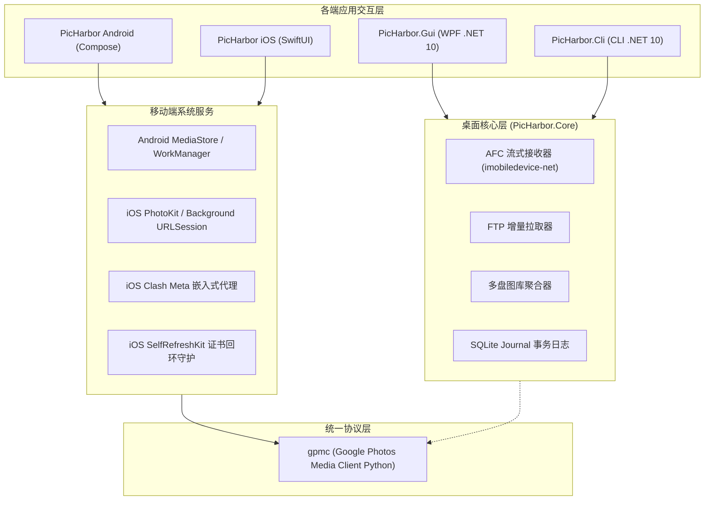

# 系统架构与工程全景

PicHarbor 采用分层解耦、本地优先（Local-First）与事实优先（Evidence-First）的工程架构。

---

## 总体系统架构

---

## 桌面端设计原则

1. **零损坏状态机**：
   - 采用 `Microsoft.Data.Sqlite` 维护 `.picharbor/journal.db`；
   - 任务在状态机（`Pending` -> `Transferring` -> `Verifying` -> `Committed`）中单向流转；
   - 任何非 `Committed` 的文件落盘名称均为 `.partial`，杜绝伪完成副本。
2. **多盘隔离存储**：
   - 各成员盘根目录下独立的 `.picharbor` 目录存储本盘的完整元数据与指纹；
   - 机器本地缓存若意外丢失，只需重新加载磁盘，即可在几十秒内秒级重新构建全局 SQLite 索引。

---

## 移动端嵌入式 Python 设计

在常规移动开发中，接入私有或复杂协议通常依赖服务器搭建反向代理。PicHarbor 通过在移动客户端直接嵌入 Python 3.13 解释器打破了这一限制：
* **Android (Chaquopy)**：以 native library 形式集成 Python 运行时，Kotlin 通过直接对象引用传递字节流；
* **iOS (Sandboxed CPython)**：编译为符合 Apple 沙盒规则的静态框架，Swift 通过 C-API 直接桥接，既保证了原生界面的丝滑流畅，又实现了跨平台复用相同的协议底座。
