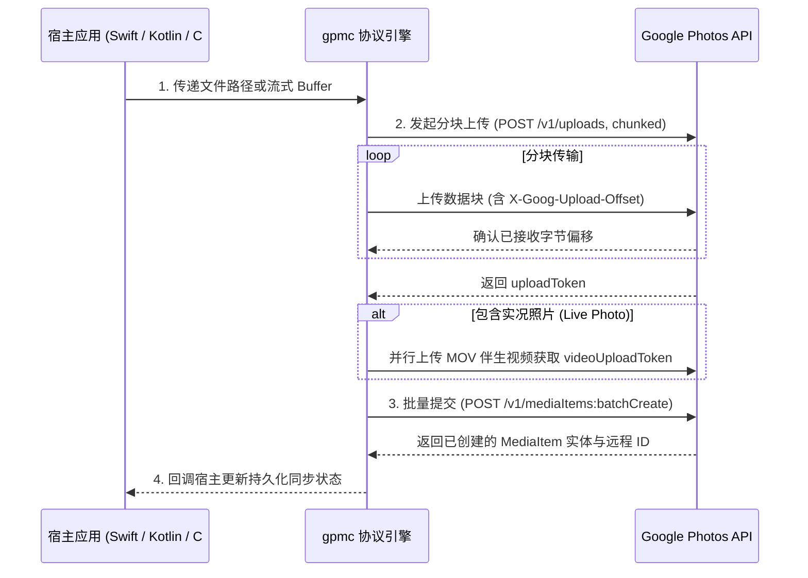

# GPMC 协议核心实现

`gpmc`（Google Photos Media Client）是跨 Android、iOS 与桌面端共享的 Python 协议核心模块。

---

## 协议通信生命周期



---

## 核心方法契约

```python
class GooglePhotosClient:
    def upload_stream(
        self,
        stream: BinaryIO,
        size: int,
        mime_type: str,
        progress_callback: Optional[Callable[[int, int], None]] = None,
    ) -> str:
        """分块上传二进制数据流，返回云端生成的 uploadToken。
        
        支持断点重试与实时进度回调。
        """
        ...

    def batch_create(
        self,
        new_media_items: List[NewMediaItem],
        album_id: Optional[str] = None,
    ) -> List[BatchCreateResult]:
        """将一个或多个已上传的 uploadToken 批量确认入库。
        
        若为实况照片，在 new_media_items 中声明配对元数据字典。
        """
        ...
```

---

## 错误码与重试矩阵

* **HTTP 401 / 403**：授权 Token 过期，触发客户端 OAuth Refresh 流程；
* **HTTP 429 / 503**：频率限制或云端限流，采用带有抖动的指数退避（Exponential Backoff with Jitter）；
* **TCP EOF / 断网**：通过 `X-Goog-Upload-Command: query` 查询已确认的字节偏移，无损无感续传后续分块。
