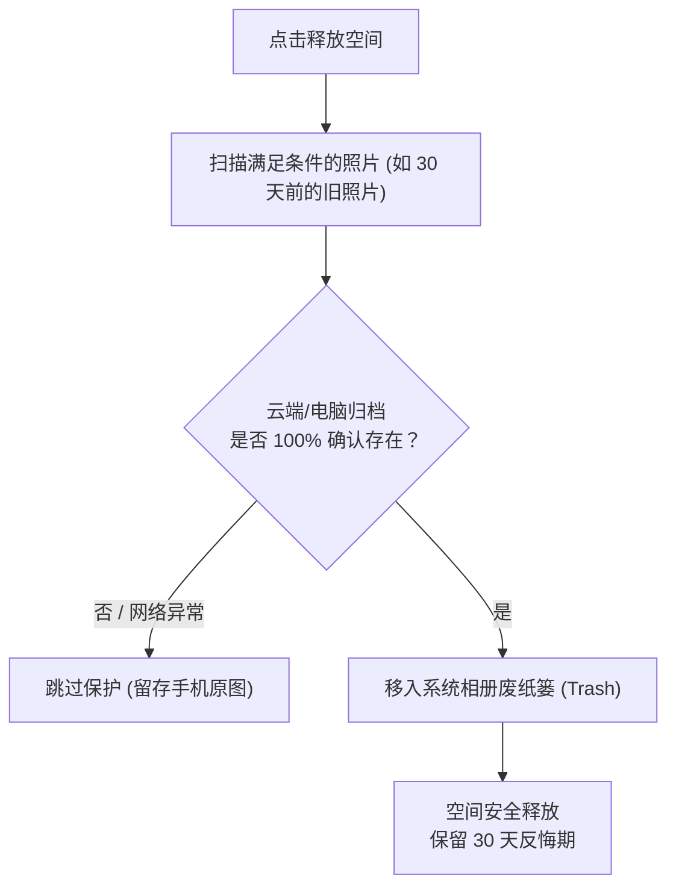

# 手机释放空间与安全防误删

当手机提示“存储空间已满”，微信、游戏都无法正常更新时，我们通常最想清理的就是动辄占用几十乃至上百 GB 的照片与 4K 视频。但大家最害怕的就是：**“如果还没备份完，手滑删了怎么办？”**

PicHarbor 提供了安全等级极高的**“释放空间 (Free Up Space)”**机制，让你放心瘦身。

---

## 核心安全防线：双重核验 (Double Confirmation)

PicHarbor 在删除手机端任何一张照片前，必须经过两重严苛校验：

1. **第一重：本地完成标记核查**
   - 检查本地数据库中该媒体是否已标记为备份成功。
2. **第二重：远程/归档真实性二次确认**
   - 客户端会主动向目标端（Google 相册或已入库的电脑归档库）发送探测；
   - 确认云端或归档盘中**确实存在该文件、大小一致且哈希无损**；
   - **只要有一丝网络不畅、校验存疑或未完全确认，该照片坚决跳过，绝不删除！**

---

## 为什么是“移入系统回收站”而不是永久抹除？

在 Android 11+ 及 iOS 系统中，PicHarbor 执行释放空间时，会调用系统相册 API 将照片放入手机自带的**“最近删除 / 废纸篓”**相册：
* **保留 30 天反悔期**：在这 30 天内，如果你随时后悔或者需要离线使用原片，可以直接在系统自带相册的废纸篓里一键“恢复”；
* 30 天后由操作系统自动永久清空，完全兼顾了安全性与自动化。

---

## 推荐的清理设置组合

* **保留近 30 天拍摄的内容**：刚拍不久的照片通常还要发朋友圈、修图或发送给朋友，建议设置“仅清理 30 天以前的内容”；
* **优先清理大体积视频**：在清理选项中勾选“仅清理视频”，几分钟内就能腾出数十 GB 空间，而手机里的日常静态照片完全不动。
