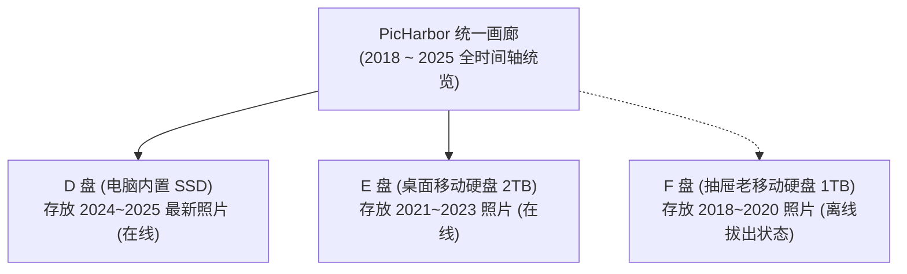

# 多硬盘与海量照片管理

摄影爱好者的照片库通常会快速突破 500 GB、1 TB 甚至数 TB。单台电脑的内置硬盘往往容纳不下，用户通常会购买多块移动硬盘。PicHarbor 的**多盘逻辑图库 (Multi-Disk Library)** 能够优雅地帮你解决多硬盘管理的痛点。

---

## 什么是“逻辑图库”？

传统文件管理器只能按盘符查看（D 盘有两年的照片，E 盘有另外三年的照片，每次找照片都要来回翻盘）。

PicHarbor 采用逻辑图库模型：
* **统一视图**：无论你的照片分散在 2 块还是 5 块移动硬盘上，打开 PicHarbor，所有照片按照一条清晰的**全局时间线**无缝展示；
* **每个盘独立自持**：每块外接硬盘上都有独立的 `.picharbor` 索引文件，带着移动硬盘去别人电脑上也能识别。

---

## 实用场景指南

### 场景 1：当前硬盘满了，怎么换盘继续备份？
1. 在电脑上插上一块新的空白移动硬盘（例如盘符为 `E:`）；
2. 打开 PicHarbor 设置 ->“图库存储与成员盘”；
3. 点击“添加新成员盘”，选择 `E:\MyNewArchive`；
4. **效果**：旧盘里的老照片继续留在旧盘，后续连接手机新备份的照片会自动写入新盘，无需手动剪切搬移！

### 场景 2：拔掉移动硬盘后会发生什么？
* 当你拔掉某块移动硬盘（例如 F 盘），软件界面上**不会报错闪退**；
* F 盘上的照片依然会在画廊中保留缩略图与拍摄时间等元数据，但右下角会贴心标记“所在磁盘处于离线状态”；
* 当你日后重新插回这块硬盘时，PicHarbor 会在 1 秒内自动检测并点亮绿灯，照片立刻恢复完整访问。

### 场景 3：如何重整历史混乱文件夹？
如果你过去几年手动整理的照片目录很乱（有的按“去三亚旅游”，有的按“20230501”）：
1. 在设置中点击“重整已有目录”；
2. 选择源目录与目标布局（如标准的 `年/月 (year-month)`）；
3. 软件会根据每张照片的真实 EXIF 拍摄时间，在物理磁盘上自动无损归档归位，告别杂乱无章。
